---
defaults:
  layout: two-cols
mdc: true
fonts:
  mono: Cascadia Mono
  sans: Atkinson Hyperlegible
layout: cover
---

# Shear & Moment Diagrams

## Finding the spot where a beam breaks first

---

# A Human Cantilever

* Benjamin Baker built this _living model_ to explain the Forth Bridge
* Each outer man is a _cantilever_: a beam fixed at one end only
* His arms carry tension. The sticks carry compression
* By the end of today you'll know why the tension is on top

::right::

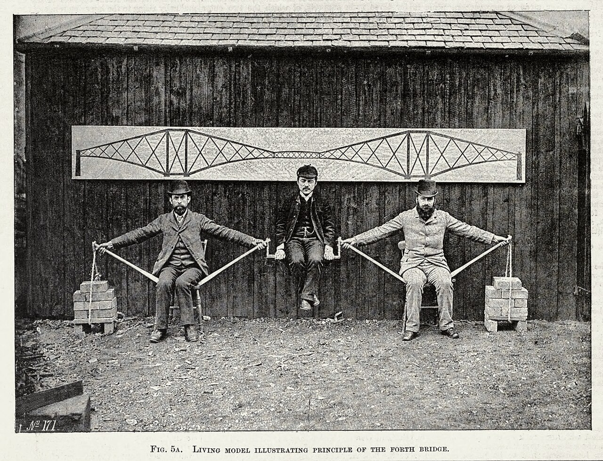

---

# Beams

* A _beam_ is a long member loaded transverse to its axis
* A _simply supported_ beam sits on a pin and a roller
* A _cantilever_ is fixed at one end and free at the other
* Today you'll find the internal forces at every point along a beam

::right::

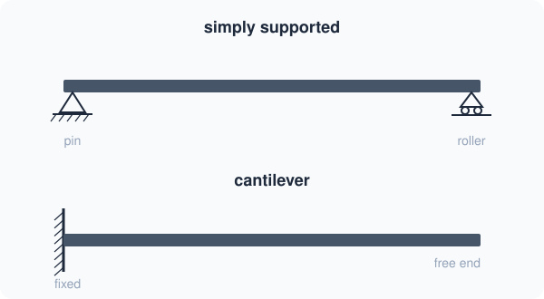

---

# Internal Forces

* Cut the beam anywhere. This is the _method of sections_
* The cut face carries a _shear force_ V: the vertical force across the cut
* It also carries a _bending moment_ M: the couple across the cut
* Each piece must be in equilibrium on its own

::right::

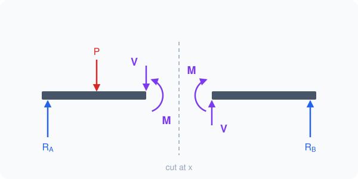

---

# Sign Convention

* Positive V: up on a left face, down on a right face
* Positive M is _sagging_: the beam bends into a smile
* Negative M is _hogging_: the beam bends into a frown
* I'll use this convention for the whole lecture

::right::

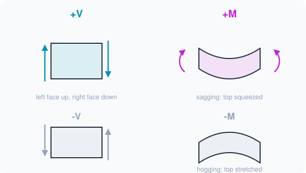

---

# Point Load: Reactions

* Start with one point load P, a distance a from support A
* Sum of moments about A: $R_B L = Pa$, so $R_B = Pa/L$
* Sum of vertical forces: $R_A = P - R_B = Pb/L$

::right::

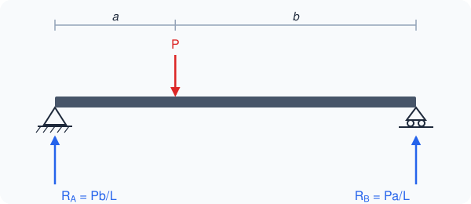

---

# Point Load: Diagrams

* A _shear diagram_ plots V(x). A _moment diagram_ plots M(x)
* Left of the load, $V = R_A = Pb/L$
* At the load, V drops by P
* M climbs linearly to $Pab/L$ under the load, then falls back to zero

::right::

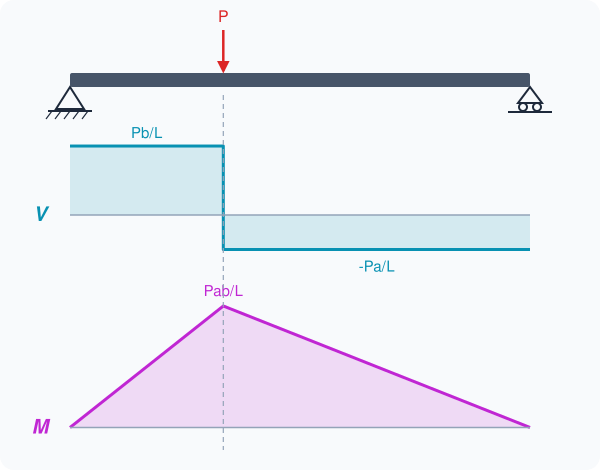

---

# Moving the Load

* Demo: drag P along the span
* The peak moment is always under the load
* $Pab/L$ is largest at midspan, where it's $PL/4$

::right::

<point-load-lab />

---

# Distributed Loads

* A _distributed load_ w(x) is a force per unit length, e.g. kN/m
* For equilibrium, replace it with its _resultant_: the area under w(x)
* The resultant acts at the _centroid_ of that area
* Uniform: wL at L/2. Triangle: $w_0L/2$ at 2L/3 from the zero end

::right::

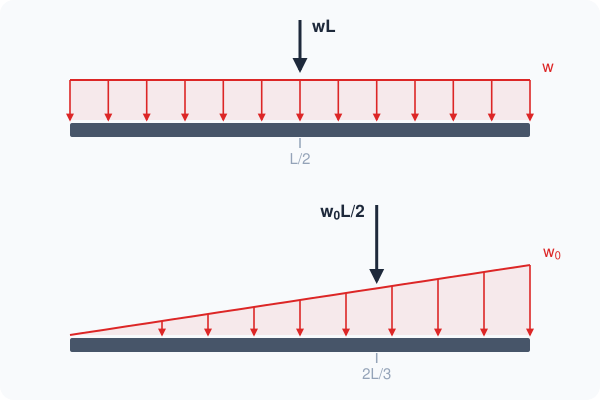

---

# Uniform Load

* Next, a _uniform load_ w over the whole span
* By symmetry, $R_A = R_B = wL/2$
* Cut at x: $V = \frac{wL}{2} - wx$
* $M = \frac{wLx}{2} - \frac{wx^2}{2}$. It peaks at $wL^2/8$ at midspan

::right::

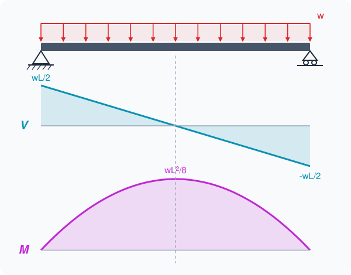

---

# Load, Shear, Moment

* Now let's look at a slice of the beam, dx long
* Sum of vertical forces on the slice: $\frac{dV}{dx} = -w$
* Sum of moments on the slice: $\frac{dM}{dx} = V$

::right::

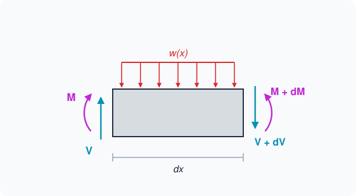

---

# Area Method

* Integrate both: $V_2 - V_1 = -\int w\,dx$
* $M_2 - M_1 = \int V\,dx$: the area under the V diagram
* The shaded V triangle has area $wL^2/8$
* That's M at midspan. No section cut needed!

::right::

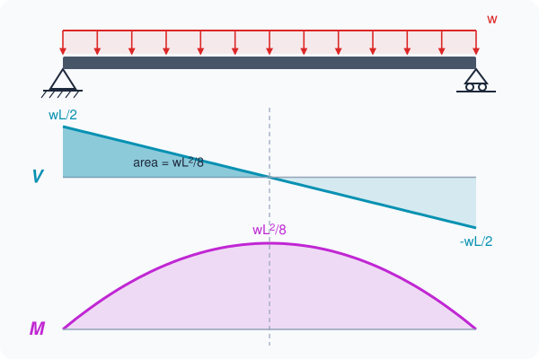

---

# Shape Rules

* Each integration raises the polynomial degree by one
* Uniform w gives a linear V and a parabolic M
* Linear w gives a parabolic V and a cubic M
* Since $dM/dx = V$, M has a peak where V = 0

::right::

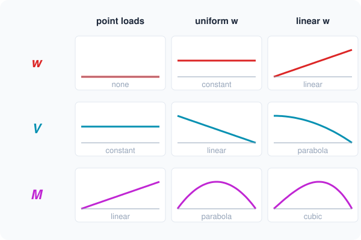

---

# Jumps

* A point load P makes V jump by P
* It puts a _kink_ in M: the slope changes, the value doesn't
* A _couple_ C is a concentrated moment. It makes M jump by C
* V doesn't change at a couple

::right::

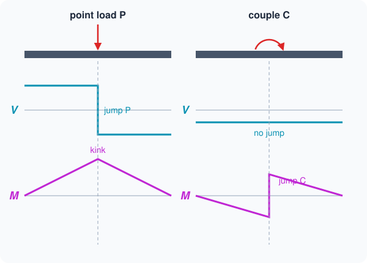

---

# Linear Loads

* A _linearly varying load_ grows in a straight line from zero to a peak _intensity_ $w_0$
* On a span of length L: $w(x) = w_0 x / L$
* Water pressure is linear in depth: $p = \rho g h$
  * $\rho$ is the density, g is gravity and h is the depth
* Soil pressure on a retaining wall is also modeled as linear

::right::

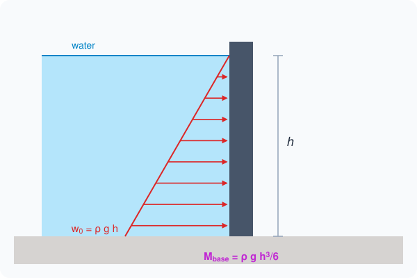

---

# Linear Load: Reactions

* The resultant $w_0L/2$ acts at 2L/3 from A
* Moments about A: $R_B L = \frac{w_0 L}{2} \cdot \frac{2L}{3}$, so $R_B = w_0L/3$
* Vertical forces: $R_A = \frac{w_0L}{2} - \frac{w_0L}{3} = \frac{w_0L}{6}$
* The heavy end gets twice the reaction

::right::

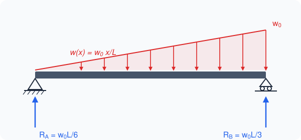

---

# Linear Load: Cutting

* Cut at x. The load left of the cut is a smaller triangle
* Its resultant is $\frac{w_0 x^2}{2L}$, acting x/3 from the cut
* $V(x) = \frac{w_0L}{6} - \frac{w_0x^2}{2L}$
* $M(x) = \frac{w_0Lx}{6} - \frac{w_0x^3}{6L}$

::right::

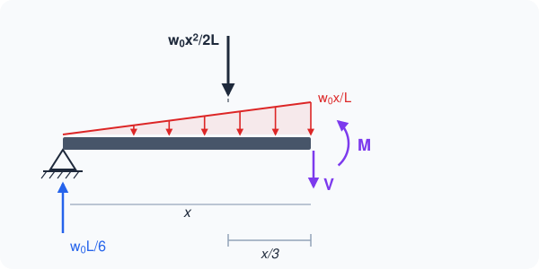

---

# Linear Load: Diagrams

* V is a parabola. M is a cubic
* V = 0 at $x = L/\sqrt{3} \approx 0.577L$
* $M_{max} = \frac{w_0L^2}{9\sqrt{3}} \approx 0.064\,w_0L^2$
* Question: why isn't the peak at midspan?

::right::

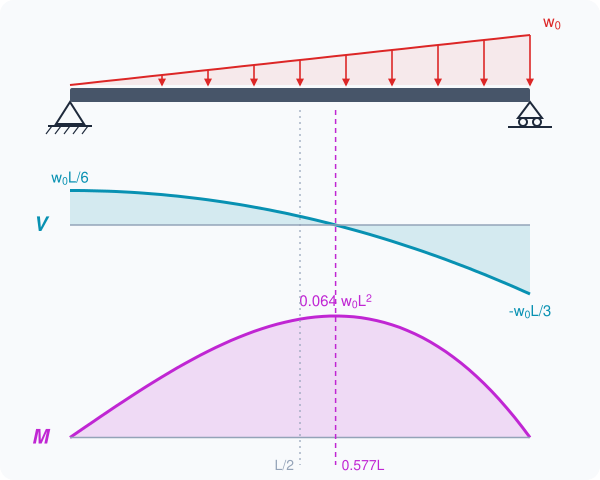

---

# Linear Load: Diagrams

* Answer: more of the load sits on the right half
* M peaks where V = 0: where the load left of the cut equals $R_A$
* $\frac{w_0x^2}{2L} = \frac{w_0L}{6}$ gives $x = L/\sqrt{3}$
* So the peak moves toward the heavy end

::right::

---

# Cantilevers

* Now let's look at cantilevers: diving boards, balconies, aircraft wings
* A _fixed support_ resists force in both directions and resists rotation
* That gives three reactions: $R_A$, $H_A$ & $M_A$
* For vertical loads only, $H_A = 0$

::right::

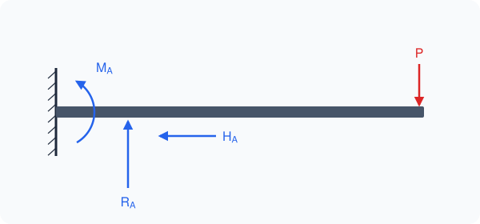

---

# Free End

* You can skip the wall reactions entirely
* Cut at x and keep the piece with the free end
* That piece carries only known loads, plus V and M at the cut
* I'll measure x from the wall

::right::

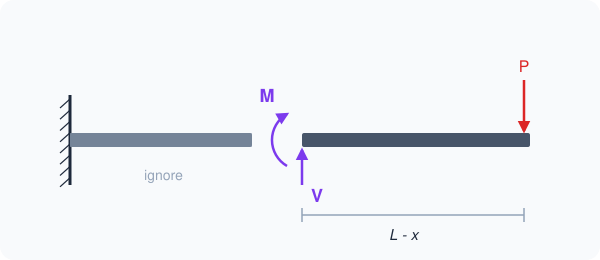

---

# Cantilever: Tip Load

* Vertical forces on the free piece: $V = P$
* Moments about the cut: $M = -P(L - x)$
* M is negative everywhere: the beam hogs
* $|M|$ is largest at the wall, where it's PL

::right::

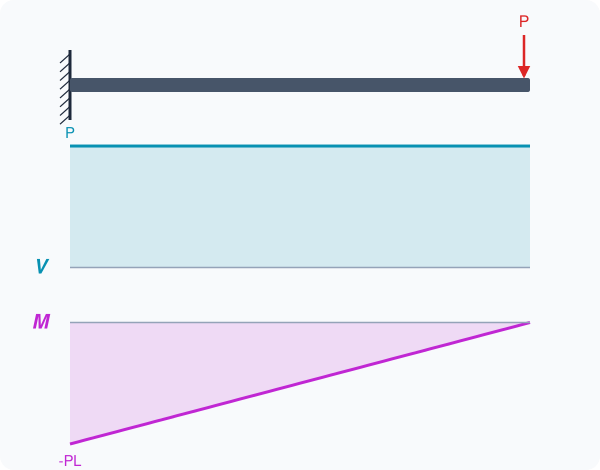

---

# Cantilever: Uniform Load

* The free piece carries $w(L - x)$, acting at its middle
* $V = w(L - x)$
* $M = -\frac{w(L - x)^2}{2}$
* At the wall: $V = wL$ and $M = -wL^2/2$

::right::

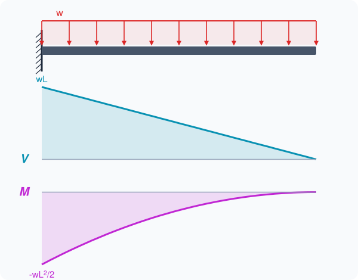

---

# Cantilever: Linear Load

* Now the load is $w_0$ at the wall and zero at the tip
* Let $u = L - x$. The free piece carries $\frac{w_0 u^2}{2L}$, acting u/3 from the cut
* $V = \frac{w_0 u^2}{2L}$ and $M = -\frac{w_0 u^3}{6L}$
* At the wall, $M = -w_0L^2/6$
* Question: flip the triangle so $w_0$ is at the tip. Does the wall moment go up or down?

::right::

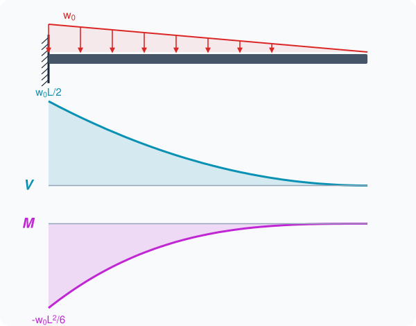

---

# Cantilever: Flipped Load

* Answer: it doubles, to $-w_0L^2/3$
* The resultant is still $w_0L/2$
* Its lever arm grows from L/3 to 2L/3
* A load near the tip makes more wall moment than the same load near the wall

::right::

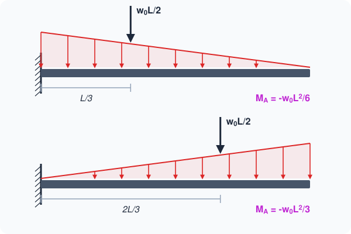

---

# Retaining Wall

* A wall that holds back water is a vertical cantilever, fixed at the base
* Per meter of wall, $w_0 = \rho g h$ at the base
* $V_{base} = \rho g h^2/2$ and $M_{base} = \rho g h^3/6$
* For h = 1.5 m: $w_0 = 14.7$ kN/m, $V = 11.0$ kN, $M = 5.5\ \text{kN}\cdot\text{m}$

::right::

---

# Depth Cubed

* Demo: raise the water level
* $M_{base}$ grows with $h^3$
* Double the depth and the base moment goes up 8x

::right::

<wall-lab />

---

# Where Rebar Goes

* Concrete is strong in compression and weak in tension
* Steel _rebar_ carries the tension
* A cantilever hogs, so its tension is on top
* So balcony rebar goes in the top of the slab
* Baker's arms are the top rebar

::right::

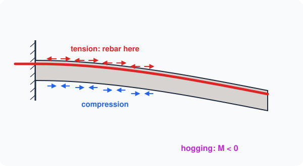

---
layout: default
---

# Summary

* V and M are the internal force and couple at a cut
* Method of sections: cut, keep one piece, apply equilibrium
* $dV/dx = -w$ and $dM/dx = V$
* Each integration raises the degree: linear w gives a parabolic V and a cubic M
* M peaks where V = 0
* Linear load on a simple span: $M_{max} \approx 0.064\,w_0L^2$ at 0.577L
* Cantilevers: keep the free end. $|M|$ is largest at the wall
* Hogging puts the tension on top

---
layout: end
---

# Shear & Moment Diagrams

## Finding the spot where a beam breaks first
